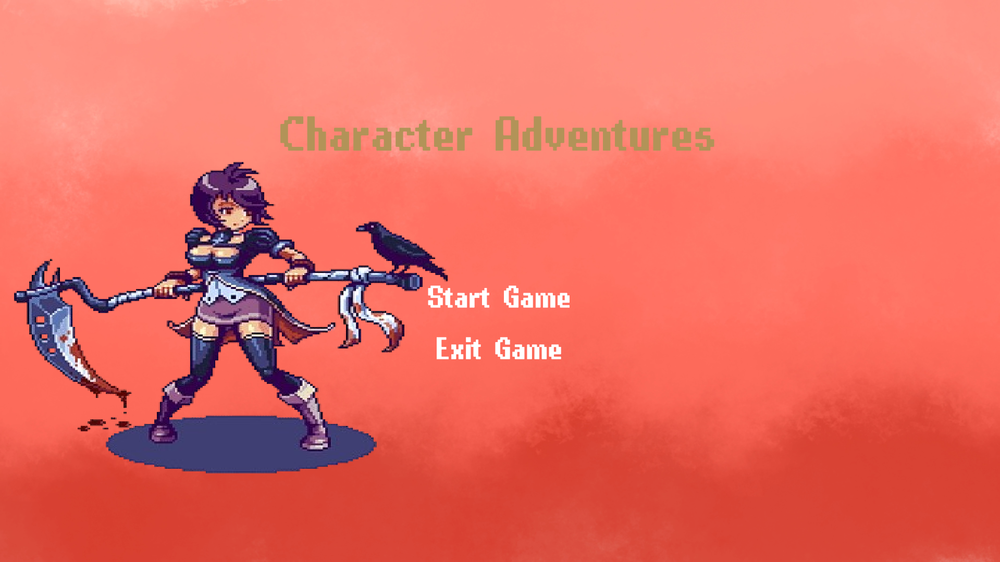
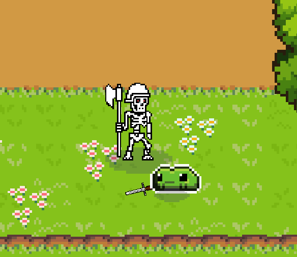
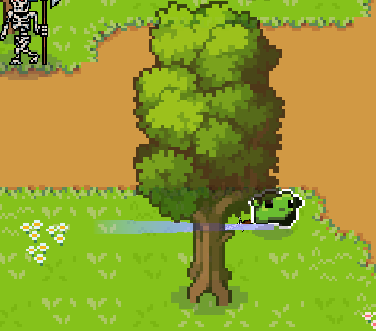
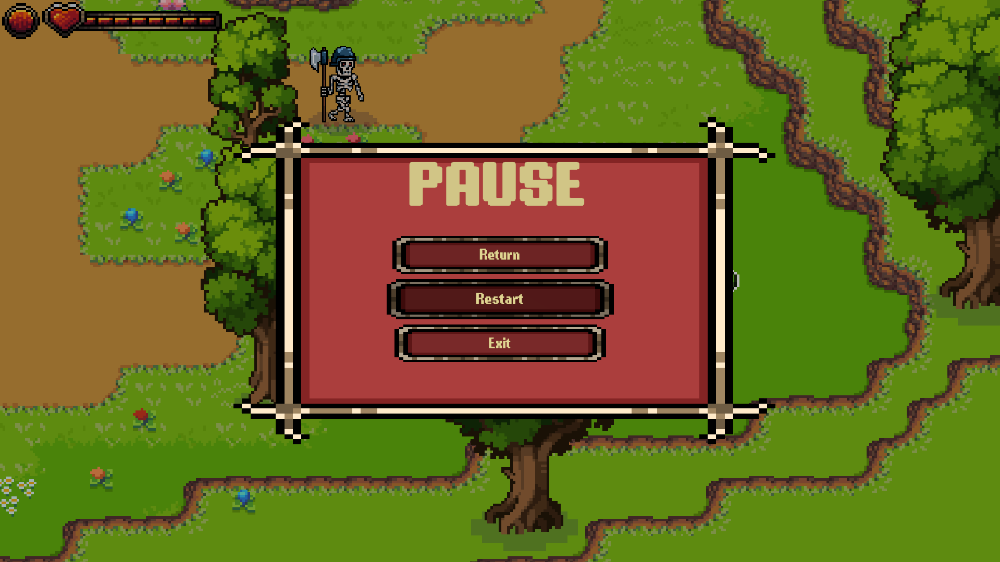
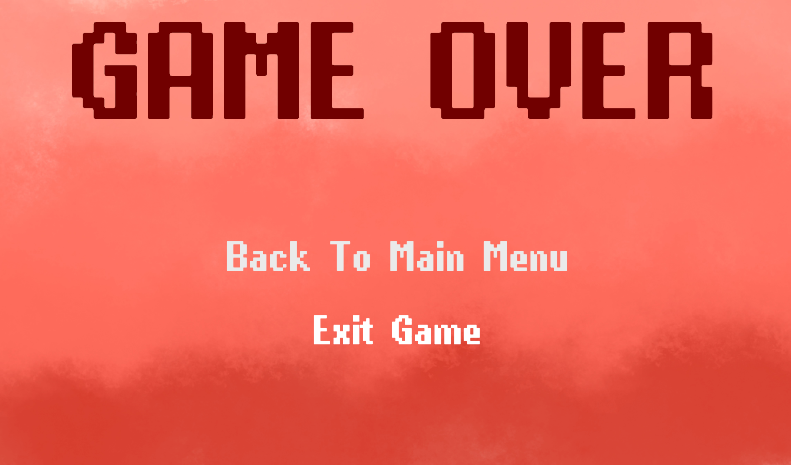

# 🐸 2D Top-Down Shooter

  <strong>A 2D top-down action game made with Unity 6 and C#.</strong>
   
  Play as a brave frog, fight skeletons, dash through danger, and destroy obstacles!

  
  
  
  
  

---

## 🎮 About the Game

Explore a 2D world from a top-down perspective, battle skeleton enemies, and destroy obstacles in your path. Manage your health, use your dash to avoid danger, and survive for as long as you can!

## ✨ Features

- 🐸 **Player Movement** — Explore the map and move freely.
- 💨 **Dash Mechanic** — Dash to avoid danger and reposition during combat.
- 💀 **Skeleton Enemies** — Fight skeletons that move around the map.
- ❤️ **Health System** — Take damage and regenerate health after avoiding damage for a short time.
- 🪨 **Destructible Objects** — Destroy obstacles throughout the map.
- 💾 **Save System** — The game includes a save system.
- 🏠 **Main Menu** — Start your adventure from the main menu.
- ⏸️ **Pause Menu** — Resume or restart your game.
- ☠️ **Game Over Screen** — A dedicated screen appears when the player dies.

## 📸 Screenshots

### 🏠 Main Menu

### 🕹️ Gameplay & HUD

### ⚔️ Combat

### 💨 Dash

### ⏸️ Pause Menu

### ☠️ Game Over

## 🛠️ Built With

| Technology | Description |
|---|---|
| 🎮 Unity 6 | Game engine |
| 💻 C# | Gameplay programming |
| ⌨️ Keyboard | Input method |
| 🎨 Ready-made assets | Game visuals |

## 🎹 Controls

The game uses keyboard controls. Specific key bindings can be documented here.

## 🎬 Gameplay Video

[▶️ Watch Gameplay](Videos/Top-Down-Shooter-Gameplay.mp4)

## 📥 Download

A Windows build will be published in the **[Releases](../../releases)** section when available.

## 🎯 Project Goals

This project was created as part of my game development portfolio to practice:

- Gameplay programming with C#
- Player movement and dash mechanics
- Enemy behaviour
- Health and regeneration systems
- Destructible objects
- UI and menu implementation
- Save system implementation

---

  <strong>🎮 Made with Unity 6</strong>
   
  <em>Thanks for checking out my project! ⭐</em>

